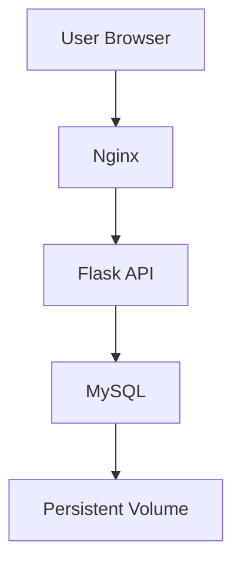

> **Note:** This article is intentionally beginner-friendly. I have explained the commands, Kubernetes resources, networking, storage, health checks, troubleshooting, and the real issues encountered during the project instead of only showing the final YAML.

---

## 🚀 What We Are Building

In this project, we will deploy a complete **three-tier DevOps Learning Tracker** application on a local Kubernetes cluster using **Minikube**.

The application contains:

- Frontend using HTML, CSS and JavaScript
- Nginx as a reverse proxy
- Python Flask backend
- MySQL database
- Persistent storage using Kubernetes PVC
- Kubernetes Deployments
- Kubernetes Services
- Kubernetes Secret
- Kubernetes ConfigMap
- Kubernetes health probes
- Kubernetes initContainer
- Minikube
- Docker images
- Docker Hub

The final architecture looks like this:

```text
                         USER
                          │
                          │ HTTP
                          ▼
                ┌─────────────────────┐
                │       NGINX         │
                │  Reverse Proxy      │
                │  Frontend Server    │
                │                     │
                │     NodePort        │
                │       30082         │
                └──────────┬──────────┘
                           │
                           │ /api/*
                           ▼
                ┌─────────────────────┐
                │       FLASK         │
                │     REST API        │
                │                     │
                │     ClusterIP       │
                │       :5000         │
                └──────────┬──────────┘
                           │
                           │ MySQL
                           ▼
                ┌─────────────────────┐
                │       MYSQL         │
                │      MySQL 8.4      │
                │                     │
                │     ClusterIP       │
                │       :3306         │
                └──────────┬──────────┘
                           │
                           ▼
                ┌─────────────────────┐
                │       PVC           │
                │   mysql-pvc         │
                │       1Gi           │
                └─────────────────────┘
```

The important idea is:

```text
Browser
   ↓
Nginx
   ↓
Flask
   ↓
MySQL
   ↓
Persistent Storage
```

Only Nginx is exposed outside the Kubernetes cluster.

---

# 👋 Introduction

Hi! I'm **Hritik Ranjan**, a DevOps and Cloud learner.

In my DevOps learning journey, I built a small three-tier application called **DevOps Learning Tracker**.

Initially, I containerized the application using Docker Compose.

The Docker Compose architecture looked like:

```text
Frontend
   ↓
Nginx
   ↓
Flask
   ↓
MySQL
```

Docker Compose was a great way to understand:

- Containers
- Images
- Networks
- Volumes
- Environment variables
- Service dependencies
- Health checks
- Reverse proxy configuration

But then I wanted to understand the next level:

> **How would I run the same application using Kubernetes?**

So I migrated the application from Docker Compose to Kubernetes using **Minikube**.

And this is where things became much more interesting.

I encountered real problems involving:

- Docker build context
- Port conflicts
- MySQL startup timing
- Docker BuildKit
- `ImagePullBackOff`
- Missing Secrets
- MySQL CrashLoopBackOff
- PVC permissions
- InnoDB corruption
- Nginx `502 Bad Gateway`
- Kubernetes service discovery
- Pod readiness
- Persistent storage

This article documents the complete journey.

---

# 🎯 What You Will Learn

By the end of this guide, you will understand:

- What the DevOps Learning Tracker does
- Why the application is divided into three tiers
- Docker Compose architecture
- Kubernetes architecture
- Minikube
- Namespaces
- Pods
- Deployments
- Services
- NodePort
- ClusterIP
- ConfigMaps
- Secrets
- PersistentVolumes
- PersistentVolumeClaims
- Docker images in Minikube
- `imagePullPolicy`
- Init containers
- Readiness probes
- Liveness probes
- Kubernetes DNS
- MySQL persistence
- Kubernetes networking
- Troubleshooting
- Docker Compose → Kubernetes migration
- Real-world deployment problems
- Useful Kubernetes commands
- DevOps interview questions

---

# 📚 Table of Contents

1. [Project Overview](#project-overview)
2. [What Does the Application Do?](#what-does-the-application-do)
3. [Why Build This Project?](#why-build-this-project)
4. [Docker Compose Architecture](#docker-compose-architecture)
5. [Kubernetes Architecture](#kubernetes-architecture)
6. [Technology Stack](#technology-stack)
7. [Prerequisites](#prerequisites)
8. [Project Repository](#project-repository)
9. [Project Structure](#project-structure)
10. [Installing Docker](#step-1-install-docker)
11. [Installing kubectl](#step-2-install-kubectl)
12. [Installing Minikube](#step-3-install-minikube)
13. [Installing Git](#step-4-install-git)
14. [Cloning the Repository](#step-5-clone-the-project)
15. [Docker Images](#step-6-understanding-the-docker-images)
16. [Starting Minikube](#step-7-start-minikube)
17. [Loading Images into Minikube](#step-8-load-images-into-minikube)
18. [Kubernetes Manifests](#step-9-understanding-the-kubernetes-manifests)
19. [Namespace](#step-10-namespace)
20. [Secret](#step-11-secret)
21. [ConfigMap](#step-12-configmap)
22. [PersistentVolumeClaim](#step-13-persistent-volume-claim)
23. [MySQL Deployment](#step-14-mysql-deployment)
24. [MySQL Service](#step-15-mysql-service)
25. [Flask Deployment](#step-16-flask-deployment)
26. [Flask Service](#step-17-flask-service)
27. [Nginx Deployment](#step-18-nginx-deployment)
28. [Nginx NodePort Service](#step-19-nginx-service)
29. [Deploying the Application](#step-20-deploy-the-application)
30. [Checking Pods](#step-21-check-the-pods)
31. [Checking Services](#step-22-check-services)
32. [Checking PVC](#step-23-check-storage)
33. [Accessing the Application](#step-24-access-the-application)
34. [Testing the Application](#step-25-test-the-application)
35. [Testing the Flask API](#step-26-test-the-flask-api)
36. [Testing MySQL](#step-27-test-mysql)
37. [Testing Persistent Storage](#step-28-test-data-persistence)
38. [Docker Compose vs Kubernetes](#docker-compose-vs-kubernetes)
39. [Complete Request Flow](#complete-request-flow)
40. [Kubernetes Networking](#kubernetes-networking)
41. [Health Checks](#health-checks)
42. [Real Issues and Fixes](#real-issues-and-fixes)
43. [Troubleshooting Commands](#troubleshooting-commands)
44. [Security Considerations](#security-considerations)
45. [Production Improvements](#production-improvements)
46. [DevOps Interview Questions](#devops-interview-questions)
47. [What I Learned](#what-i-learned)
48. [Future Improvements](#future-improvements)
49. [Useful Documentation](#useful-documentation)
50. [Conclusion](#conclusion)

---

# 🏗️ Project Overview

The **DevOps Learning Tracker** is a simple web application designed to track DevOps learning topics.

For example, I can add:

```text
Docker
Kubernetes
AWS
Jenkins
Terraform
Ansible
Linux
Git
GitHub Actions
Prometheus
Grafana
```

Each topic can contain:

- Topic name
- Category
- Status
- Progress percentage

The application also calculates useful statistics.

For example:

```text
Total Topics       → 10
Completed          → 4
In Progress        → 4
Not Started        → 2
Average Progress   → 68%
```

The application itself is intentionally simple.

The goal is not to build a complicated business application.

The goal is to learn **DevOps architecture and deployment**.

---

# 💡 Why Build This Project?

A simple application is actually useful for learning DevOps because it gives us something real to deploy.

Instead of learning Kubernetes using only:

```text
nginx
hello-world
simple deployment
```

we have a complete multi-tier application.

We have:

```text
Frontend
Backend
Database
Storage
Networking
Configuration
Secrets
Reverse Proxy
Health Checks
```

That gives us a much better environment for learning.

---

# 🧩 Three-Tier Architecture

The application follows a three-tier architecture.

```text
┌──────────────────────────────┐
│        Presentation Tier     │
│                              │
│     HTML + CSS + JavaScript  │
│            Nginx             │
└──────────────┬───────────────┘
               │
               ▼
┌──────────────────────────────┐
│       Application Tier       │
│                              │
│          Flask API           │
└──────────────┬───────────────┘
               │
               ▼
┌──────────────────────────────┐
│           Data Tier          │
│                              │
│           MySQL              │
│                              │
│             ↓                │
│            PVC               │
└──────────────────────────────┘
```

---

# 🐳 Docker Compose Architecture

Before Kubernetes, the application was containerized using Docker Compose.

Docker Compose allows multiple related containers to be defined and managed from a YAML configuration.

The architecture was:

```text
                  Browser
                     │
                     ▼
              ┌─────────────┐
              │    Nginx    │
              │    :80      │
              └──────┬──────┘
                     │
                     ▼
              ┌─────────────┐
              │   Flask     │
              │   :5000     │
              └──────┬──────┘
                     │
                     ▼
              ┌─────────────┐
              │   MySQL     │
              │   :3306     │
              └──────┬──────┘
                     │
                     ▼
              Docker Volume
```

Docker Compose handled:

- Services
- Networking
- Environment variables
- Volumes
- Health checks
- Dependencies

---

# ☸️ Why Kubernetes?

Docker Compose is excellent for local multi-container development.

But Kubernetes provides many additional capabilities for managing containerized applications.

Kubernetes can help with:

- Self-healing
- Service discovery
- Scaling
- Rolling updates
- Configuration management
- Secrets
- Persistent storage
- Health checks
- Load balancing
- Desired-state management

Official Kubernetes documentation describes Kubernetes as a platform for managing containerized workloads and services. ([Kubernetes](https://kubernetes.io/docs/concepts/?utm_source=chatgpt.com))

For this project, I wanted to understand those concepts practically.

---

# 🏛️ Final Kubernetes Architecture

Here is the final architecture:

```text
                         ┌───────────────┐
                         │     USER      │
                         │   Browser     │
                         └───────┬───────┘
                                 │
                                 │ HTTP
                                 ▼
                    ┌────────────────────────┐
                    │         NGINX          │
                    │                        │
                    │  Frontend + Proxy      │
                    │                        │
                    │     NodePort: 30082    │
                    └───────────┬────────────┘
                                │
                                │ /api/*
                                ▼
                    ┌────────────────────────┐
                    │        FLASK           │
                    │                        │
                    │      REST API          │
                    │      ClusterIP         │
                    │        :5000           │
                    └───────────┬────────────┘
                                │
                                │ db:3306
                                ▼
                    ┌────────────────────────┐
                    │        MYSQL           │
                    │                        │
                    │       MySQL 8.4        │
                    │       ClusterIP        │
                    │        :3306           │
                    └───────────┬────────────┘
                                │
                                │
                                ▼
                    ┌────────────────────────┐
                    │          PVC           │
                    │       mysql-pvc        │
                    │          1Gi           │
                    └────────────────────────┘
```

---

# 🔍 Understanding the Request Flow

Suppose the user opens:

```text
http://<minikube-ip>:30082
```

The request travels like this:

```text
Browser
   │
   ▼
NodePort 30082
   │
   ▼
Nginx Service
   │
   ▼
Nginx Pod
   │
   ├── Frontend files
   │
   └── /api/*
          │
          ▼
       Flask Service
          │
          ▼
       Flask Pod
          │
          ▼
       MySQL Service
          │
          ▼
       MySQL Pod
          │
          ▼
       PVC
```

This is the most important flow to understand.

---

# 🛠️ Technology Stack

| Layer | Technology |
| --- | --- |
| Frontend | HTML, CSS, JavaScript |
| Reverse Proxy | Nginx |
| Backend | Python 3, Flask, Flask-CORS |
| Database | MySQL 8.4 |
| Containerization | Docker |
| Local orchestration | Kubernetes |
| Kubernetes environment | Minikube |
| CLI | kubectl |
| Registry | Docker Hub |
| Storage | PersistentVolumeClaim |
| Configuration | ConfigMap |
| Secrets | Kubernetes Secret |

---

# 📦 Prerequisites

Before starting, make sure you have:

| Requirement | Minimum |
| --- | --- |
| Operating System | Ubuntu 20.04+, macOS, or Windows + WSL2 |
| RAM | 4 GB free |
| CPU | 2 cores |
| Disk | 5 GB free |
| Internet | Required for initial image downloads |
| Docker | Installed |
| kubectl | Installed |
| Minikube | Installed |
| Git | Installed |

For this tutorial, Linux/Ubuntu commands are used.

---

# 📁 Project Repository

The Kubernetes version of the project is:

```text
github.com/hritikranjan1/devops-learning-tracker-k8s
```

The project contains both application code and Kubernetes manifests.

---

# 📂 Project Structure

The repository looks like this:

```text
devops-learning-tracker-k8s/
│
├── backend/
│   ├── Dockerfile
│   ├── app.py
│   └── requirements.txt
│
├── frontend/
│   ├── index.html
│   ├── style.css
│   └── script.js
│
├── nginx/
│   ├── Dockerfile
│   └── nginx.conf
│
├── k8s/
│   ├── 00-namespace.yaml
│   ├── 01-secret.yaml
│   ├── 02-configmap.yaml
│   ├── 03-mysql-pvc.yaml
│   ├── 04-mysql-deployment.yaml
│   ├── 05-mysql-service.yaml
│   ├── 06-backend-deployment.yaml
│   ├── 07-backend-service.yaml
│   ├── 08-nginx-deployment.yaml
│   └── 09-nginx-service.yaml
│
├── README.md
├── USER_GUIDE.md
├── ARCHITECTURE.md
├── WORKFLOW.md
├── ISSUES.md
└── INTERVIEW_QA.md
```

The Kubernetes manifests are numbered so they can be applied in a logical order.

---

# 🖼️ Free Visuals for the Article

You can use the following open-source icon CDN images inside Hashnode if you want a more attractive article.

```markdown


```

You can also use Mermaid diagrams in sections where Hashnode supports Mermaid rendering.

For example:



Another useful visual:


These diagrams are especially useful because they are directly connected to the architecture of this project.

---

# 🚀 Step 1 — Install Docker

Docker is required because Minikube will use the Docker driver.

On Ubuntu:

```bash
sudo apt update
sudo apt install -y docker.io
```

Start Docker:

```bash
sudo systemctl enable --now docker
```

Add your user to the Docker group:

```bash
sudo usermod -aG docker $USER
```

Apply the group without logging out:

```bash
newgrp docker
```

Verify:

```bash
docker --version
```

Also verify Docker is running:

```bash
docker ps
```

If Docker is working, you should not receive a permission error.

---

# 🚀 Step 2 — Install kubectl

`kubectl` is the command-line tool used to communicate with the Kubernetes API server.

Download the latest stable version:

```bash
curl -LO "https://dl.k8s.io/release/$(curl -L -s https://dl.k8s.io/release/stable.txt)/bin/linux/amd64/kubectl"
```

Install it:

```bash
sudo install -o root -g root -m 0755 kubectl /usr/local/bin/kubectl
```

Remove the downloaded binary:

```bash
rm kubectl
```

Verify:

```bash
kubectl version --client
```

---

# 🚀 Step 3 — Install Minikube

Minikube creates a local Kubernetes environment.

Download Minikube:

```bash
curl -LO https://storage.googleapis.com/minikube/releases/latest/minikube-linux-amd64
```

Install it:

```bash
sudo install minikube-linux-amd64 /usr/local/bin/minikube
```

Remove the downloaded file:

```bash
rm minikube-linux-amd64
```

Verify:

```bash
minikube version
```

---

# 🚀 Step 4 — Install Git

If Git is not installed:

```bash
sudo apt install -y git
```

Verify:

```bash
git --version
```

---

# 📥 Step 5 — Clone the Project

Move to your Desktop:

```bash
cd ~/Desktop
```

Clone the repository:

```bash
git clone https://github.com/hritikranjan1/devops-learning-tracker-k8s.git
```

Move into the project:

```bash
cd devops-learning-tracker-k8s
```

Check the files:

```bash
ls
```

---

# 🐳 Step 6 — Understand the Docker Images

The Kubernetes deployment uses three main images.

### MySQL

```text
mysql:8.4
```

This is the database image.

### Flask Backend

```text
hritikranjan1/devops-learning-tracker-backend:1.0
```

This contains the Flask API.

### Nginx

```text
hritikranjan1/devops-learning-tracker-nginx:1.0
```

This contains Nginx, the frontend files and reverse proxy configuration.

---

# 📥 Pull the Images

Run:

```bash
docker pull mysql:8.4
```

```bash
docker pull hritikranjan1/devops-learning-tracker-backend:1.0
```

```bash
docker pull hritikranjan1/devops-learning-tracker-nginx:1.0
```

Verify:

```bash
docker images | grep -E "mysql|devops-learning"
```

You should see the images.

---

# ☸️ Step 7 — Start Minikube

Start Minikube using Docker:

```bash
minikube start --driver=docker --memory=4096 --cpus=2
```

Let's understand the command:

```text
minikube start
```

Starts the cluster.

```text
--driver=docker
```

Uses Docker as the Minikube driver.

```text
--memory=4096
```

Allocates approximately 4 GB RAM.

```text
--cpus=2
```

Allocates 2 CPU cores.

---

# 🔎 Verify Minikube

Run:

```bash
minikube status
```

You should see something similar to:

```text
host: Running
kubelet: Running
apiserver: Running
kubeconfig: Configured
```

Now check Kubernetes nodes:

```bash
kubectl get nodes
```

Expected:

```text
NAME       STATUS   ROLES           AGE   VERSION
minikube   Ready    control-plane   ...   v1.xx.x
```

The important part is:

```text
STATUS = Ready
```

---

# 📦 Step 8 — Load Docker Images into Minikube

This is a very important step.

Minikube has its own container environment.

Even if an image exists on your host:

```text
Host Docker
    │
    └── backend:1.0
```

that does not automatically mean the Minikube runtime has the image.

So we explicitly load the images.

Run:

```bash
minikube image load mysql:8.4
```

```bash
minikube image load hritikranjan1/devops-learning-tracker-backend:1.0
```

```bash
minikube image load hritikranjan1/devops-learning-tracker-nginx:1.0
```

Minikube officially provides `minikube image load` for loading container images into the Minikube environment. ([minikube](https://minikube.sigs.k8s.io/docs/commands/image/?utm_source=chatgpt.com))

Verify:

```bash
minikube image ls | grep -E "mysql|devops-learning"
```

You should see the images.

---

# ❓ Why Load Images Manually?

Without this step, Kubernetes may try:

```text
Pod starts
   ↓
Image not available locally
   ↓
Try Docker Hub
   ↓
Network problem
   ↓
ErrImagePull
   ↓
ImagePullBackOff
```

By loading the image:

```text
Docker image
     ↓
Minikube
     ↓
Pod
```

we avoid depending on Docker Hub during deployment.

For local development, this can be very useful.

---

# 📜 Step 9 — Understanding Kubernetes Manifests

The `k8s` directory contains:

```text
00-namespace.yaml
01-secret.yaml
02-configmap.yaml
03-mysql-pvc.yaml
04-mysql-deployment.yaml
05-mysql-service.yaml
06-backend-deployment.yaml
07-backend-service.yaml
08-nginx-deployment.yaml
09-nginx-service.yaml
```

Each YAML file describes part of the desired Kubernetes state.

Kubernetes objects are persistent API entities used to represent the desired state of resources in a cluster. ([Kubernetes](https://kubernetes.io/docs/concepts/overview/working-with-objects/?utm_source=chatgpt.com))

---

# 1️⃣ `00-namespace.yaml`

```yaml
apiVersion: v1
kind: Namespace
metadata:
  name: devtrack
```

This creates:

```text
devtrack
```

namespace.

---

# 🤔 What Is a Namespace?

A namespace provides logical separation inside a Kubernetes cluster.

Instead of putting everything into:

```text
default
```

we create:

```text
devtrack
```

Now our resources are grouped:

```text
devtrack
│
├── MySQL
├── Flask
├── Nginx
├── Services
├── Secret
├── ConfigMap
└── PVC
```

Check it:

```bash
kubectl get namespaces
```

---

# 2️⃣ `01-secret.yaml`

The database credentials are stored separately.

```yaml
apiVersion: v1
kind: Secret
metadata:
  name: db-secret
  namespace: devtrack
type: Opaque

stringData:
  MYSQL_ROOT_PASSWORD: rootpassword
  MYSQL_DATABASE: devops_tracker
  MYSQL_USER: devuser
  MYSQL_PASSWORD: devpassword
```

---

# 🔐 Why Use a Secret?

We don't want database credentials directly inside every Deployment.

Instead:

```text
Secret
  │
  ├── root password
  ├── database name
  ├── username
  └── password
```

The application can consume these values.

Kubernetes provides Secrets for storing sensitive configuration such as passwords and tokens. ([Kubernetes](https://kubernetes.io/docs/concepts/overview/?utm_source=chatgpt.com))

> **Important:** Kubernetes Secrets are not automatically equivalent to a full production secret-management system. In a production environment, additional security controls and external secret management may be appropriate.

---

# 3️⃣ `02-configmap.yaml`

Not every configuration value is secret.

For example:

```yaml
apiVersion: v1
kind: ConfigMap
metadata:
  name: db-config
  namespace: devtrack

data:
  DB_HOST: db
  DB_NAME: devops_tracker
```

---

# 🔧 ConfigMap vs Secret

A simple way to remember:

```text
ConfigMap
    ↓
Normal configuration

Secret
    ↓
Sensitive configuration
```

Examples:

### ConfigMap

```text
DB_HOST=db
DB_NAME=devops_tracker
```

### Secret

```text
DB_PASSWORD=********
```

---

# 4️⃣ `03-mysql-pvc.yaml`

This is one of the most important Kubernetes resources in the project.

```yaml
apiVersion: v1
kind: PersistentVolumeClaim
metadata:
  name: mysql-pvc
  namespace: devtrack

spec:
  accessModes:
    - ReadWriteOnce

  resources:
    requests:
      storage: 1Gi
```

---

# 💾 What Is a PVC?

PVC means:

> **PersistentVolumeClaim**

The application is asking Kubernetes:

> "I need 1 GB of persistent storage."

```text
Pod
 │
 ▼
PVC
 │
 ▼
Persistent Storage
```

Persistent volumes are designed to have a lifecycle independent of an individual Pod. ([Kubernetes](https://kubernetes.io/docs/concepts/storage/persistent-volumes/?source=post_page---------------------------&utm_source=chatgpt.com))

---

# ❓ Why Does MySQL Need Persistent Storage?

Imagine we don't use a PVC.

```text
MySQL Pod
    ↓
Database
```

The Pod gets deleted.

```text
MySQL Pod
    X
```

The database data can disappear with the Pod's ephemeral filesystem.

With a PVC:

```text
MySQL Pod
    │
    ▼
MySQL Data
    │
    ▼
PVC
```

If the Pod is recreated:

```text
Old MySQL Pod
      X
      │
      ▼
     PVC
      │
      ▼
New MySQL Pod
```

The new Pod can mount the same persistent storage.

---

# 🔐 `ReadWriteOnce`

The configuration uses:

```yaml
accessModes:
  - ReadWriteOnce
```

This means the volume is requested for read-write use from a single node.

For this local Minikube setup, that is sufficient for the single MySQL instance.

---

# 5️⃣ `04-mysql-deployment.yaml`

The MySQL workload runs using a Deployment.

Important parts include:

```yaml
spec:
  strategy:
    type: Recreate
```

and:

```yaml
template:
  spec:
    securityContext:
      fsGroup: 999
```

and:

```yaml
containers:
  - name: mysql
    image: mysql:8.4
```

---

# 🔄 Why `Recreate`?

The MySQL workload uses a single PVC.

The deployment therefore uses:

```yaml
strategy:
  type: Recreate
```

The basic idea is:

```text
Old Pod
   ↓
Stopped
   ↓
New Pod
   ↓
Starts with PVC
```

This avoids trying to run old and new instances simultaneously against the same single-writer storage setup.

---

# 👤 Why `fsGroup: 999`?

One of the actual problems encountered during this project was:

```text
Permission denied
```

The volume was not writable by the MySQL process.

The configuration uses:

```yaml
securityContext:
  fsGroup: 999
```

This helps provide appropriate group ownership/access for the mounted volume.

This became important because MySQL needs to write files into its data directory.

---

# ⏳ MySQL Startup Time

MySQL does not necessarily become ready instantly.

Especially during first initialization:

```text
Pod starts
   ↓
MySQL initializes
   ↓
Database files created
   ↓
System tables initialized
   ↓
MySQL becomes ready
```

If Kubernetes checks too aggressively, it can incorrectly consider MySQL unhealthy.

Therefore the deployment uses a longer probe initialization period.

Example:

```yaml
livenessProbe:
  initialDelaySeconds: 60
```

---

# 6️⃣ `05-mysql-service.yaml`

The MySQL Service is:

```yaml
apiVersion: v1
kind: Service

metadata:
  name: db
  namespace: devtrack

spec:
  selector:
    app: db

  ports:
    - port: 3306

  type: ClusterIP
```

---

# 🌐 Why Create a Service?

Pods are temporary.

Suppose MySQL Pod IP is:

```text
10.244.0.15
```

The Pod gets deleted.

New Pod:

```text
10.244.0.21
```

If Flask directly used the Pod IP, the configuration would break.

Instead:

```text
Flask
  ↓
db:3306
  ↓
Kubernetes Service
  ↓
MySQL Pod
```

The Service provides a stable endpoint for the application. Kubernetes Services are specifically designed to provide stable networking for changing sets of Pods. ([Kubernetes](https://kubernetes.io/docs/concepts/services-networking/service/?utm_source=chatgpt.com))

---

# 🧠 Kubernetes DNS

The Service name is:

```text
db
```

So Flask can connect using:

```text
db:3306
```

instead of:

```text
localhost:3306
```

This is extremely important.

---

# ❌ Why Not `localhost`?

Inside the Flask Pod:

```text
localhost
```

means:

```text
Flask Pod itself
```

It does not mean:

```text
MySQL Pod
```

So this is wrong:

```text
DB_HOST=localhost
```

Correct:

```text
DB_HOST=db
```

Because:

```text
db
```

is the Kubernetes Service name.

---

# 7️⃣ `06-backend-deployment.yaml`

The Flask application is deployed using a Deployment.

One particularly important section is the initContainer.

```yaml
initContainers:
  - name: wait-for-mysql
    image: mysql:8.4
    command:
      - sh
      - -c
      - |
        until mysqladmin ping -h db -u root -p"$MYSQL_ROOT_PASSWORD" --silent; do
          echo "waiting for mysql..."
          sleep 3
        done
```

---

# ⏱️ Why Use an InitContainer?

Docker Compose has a concept such as:

```yaml
depends_on:
  db:
    condition: service_healthy
```

Kubernetes does not provide the same Compose-style `depends_on` mechanism.

Instead, we can make the Flask Pod wait before its main container starts.

The flow becomes:

```text
Flask Pod starts
       │
       ▼
InitContainer starts
       │
       ▼
Check MySQL
       │
       ├── Not ready
       │      ↓
       │    Wait 3 sec
       │      ↓
       │    Check again
       │
       └── Ready
              ↓
       Flask container starts
```

This was an important part of migrating the application from Compose to Kubernetes.

---

# 8️⃣ `07-backend-service.yaml`

The Flask backend is exposed internally through a Kubernetes Service.

The Service is:

```text
web
```

and uses port:

```text
5000
```

The architecture is:

```text
Nginx
  ↓
web:5000
  ↓
Flask Pod
```

Because this is an internal backend, it doesn't need to be exposed through NodePort.

It uses:

```text
ClusterIP
```

---

# 9️⃣ `08-nginx-deployment.yaml`

Nginx handles two important responsibilities:

### 1\. Frontend

It serves:

```text
HTML
CSS
JavaScript
```

### 2\. Reverse Proxy

API requests are forwarded to Flask.

For example:

```text
/api/learning
```

is forwarded to:

```text
web:5000
```

The flow:

```text
Browser
   │
   ▼
Nginx
   │
   ├── /          → Frontend
   │
   └── /api/*    → Flask
```

---

# 🔟 `09-nginx-service.yaml`

Nginx is the only service exposed outside the cluster.

```yaml
spec:
  type: NodePort

  ports:
    - port: 80
      targetPort: 80
      nodePort: 30082
```

---

# 🌍 What Is NodePort?

NodePort exposes a Kubernetes Service on a port of the cluster node.

In our case:

```text
NodePort = 30082
```

So:

```text
Browser
   ↓
Minikube IP:30082
   ↓
Nginx Service
   ↓
Nginx Pod
```

Minikube supports NodePort access and provides the `minikube service` command for obtaining the service URL. ([minikube](https://minikube.sigs.k8s.io/docs/handbook/accessing/?utm_source=chatgpt.com))

---

# 🔢 Why 30082?

Kubernetes NodePorts normally use the range:

```text
30000-32767
```

So:

```text
30082
```

fits within that range.

---

# 🔒 Why Are Flask and MySQL Not NodePort?

Because users don't need direct access to them.

We want:

```text
Internet/User
      ↓
    Nginx
      ↓
    Flask
      ↓
    MySQL
```

Not:

```text
Internet
 ├── Nginx
 ├── Flask
 └── MySQL
```

Keeping internal services internal gives us a cleaner architecture.

---

# 🚀 Step 20 — Deploy Everything

Once the files are ready:

```bash
kubectl apply -f k8s/
```

Expected output will look similar to:

```text
namespace/devtrack created
secret/db-secret created
configmap/db-config created
persistentvolumeclaim/mysql-pvc created
deployment.apps/db created
service/db created
deployment.apps/web created
service/web created
deployment.apps/nginx created
service/nginx created
```

---

# 🔎 Step 21 — Check the Pods

Run:

```bash
kubectl get pods -n devtrack
```

Initially, you may see:

```text
NAME                    READY   STATUS
db-xxxxx                0/1     ContainerCreating
web-xxxxx               0/1     Init:0/1
nginx-xxxxx             0/1     ContainerCreating
```

Wait.

Run:

```bash
kubectl get pods -n devtrack
```

again.

Eventually:

```text
NAME                    READY   STATUS
db-xxxxx                1/1     Running
web-xxxxx               1/1     Running
nginx-xxxxx             1/1     Running
```

This is what we want.

---

# 👀 Watch Pods Live

Instead of repeatedly running the command:

```bash
kubectl get pods -n devtrack
```

you can use:

```bash
kubectl get pods -n devtrack -w
```

The `-w` means:

```text
watch
```

Kubernetes will continue showing changes.

Stop watching with:

```text
Ctrl + C
```

---

# 🔎 Step 22 — Check Services

Run:

```bash
kubectl get svc -n devtrack
```

You should see something similar to:

```text
NAME    TYPE        CLUSTER-IP      PORT(S)
db      ClusterIP   10.x.x.x        3306/TCP
web     ClusterIP   10.x.x.x        5000/TCP
nginx   NodePort    10.x.x.x        80:30082/TCP
```

The important difference:

```text
db      → ClusterIP
web     → ClusterIP
nginx   → NodePort
```

---

# 💾 Step 23 — Check the PVC

Run:

```bash
kubectl get pvc -n devtrack
```

Expected:

```text
NAME        STATUS   VOLUME   CAPACITY   ACCESS MODES
mysql-pvc   Bound    ...      1Gi        RWO
```

The important status is:

```text
Bound
```

This means the claim has been successfully associated with storage.

---

# 🔐 Step 24 — Check Secret and ConfigMap

Run:

```bash
kubectl get secret -n devtrack
```

and:

```bash
kubectl get configmap -n devtrack
```

You should see:

```text
db-secret
```

and:

```text
db-config
```

---

# 📋 Check Everything Together

One useful command:

```bash
kubectl get all -n devtrack
```

And:

```bash
kubectl get pvc,secret,configmap -n devtrack
```

---

# 🌍 Step 25 — Access the Application

Run:

```bash
minikube service nginx -n devtrack
```

Minikube will provide a URL for the Service.

The URL may look similar to:

```text
http://192.168.49.2:30082
```

Depending on your Minikube configuration, the actual address may be different.

---

# 🔗 Get Only the URL

You can also use:

```bash
minikube service nginx -n devtrack --url
```

This is useful when you want the URL without manually finding the NodePort.

---

# 🖥️ Application Dashboard

After opening the URL, the DevOps Learning Tracker dashboard should appear.

The dashboard contains:

```text
Total Topics
Average Progress
Completed Topics
Learning Topics
```

It also provides functionality for adding and managing learning items.

---

# ➕ Step 26 — Test the Application

Click:

```text
Add Learning
```

Enter:

```text
Topic:
Docker Compose

Category:
Docker

Status:
Completed

Progress:
100
```

Save it.

The application should update its statistics.

For example:

```text
Total Topics: 1
Completed: 1
Average Progress: 100%
```

---

# ➕ Add Another Topic

Add:

```text
Topic:
Kubernetes

Category:
Kubernetes

Status:
In Progress

Progress:
60
```

Now the application should show approximately:

```text
Total Topics: 2
Completed: 1
Average Progress: 80%
```

Because:

```text
(100 + 60) / 2 = 80
```

---

# 🧪 Step 27 — Test the Flask Health Endpoint

The Flask backend exposes:

```text
/api/health
```

You can test it from inside the Flask Pod.

Run:

```bash
kubectl exec -n devtrack deploy/web -- \
  wget -qO- http://localhost:5000/api/health
```

Expected:

```json
{
  "status": "healthy",
  "service": "flask"
}
```

This confirms the Flask application is responding.

---

# 🗄️ Step 28 — Test MySQL Directly

We can execute a MySQL command inside the database Pod.

Run:

```bash
kubectl exec -it -n devtrack deploy/db -- \
  mysql -u devuser -pdevpassword devops_tracker \
  -e "SELECT * FROM learning_items;"
```

You should see the stored records.

This proves:

```text
Application
   ↓
Flask
   ↓
MySQL
   ↓
Database table
```

is working.

---

# 🔍 Check Database Tables

You can also open a MySQL shell:

```bash
kubectl exec -it -n devtrack deploy/db -- \
  mysql -u devuser -pdevpassword devops_tracker
```

Then:

```sql
SHOW TABLES;
```

Check the data:

```sql
SELECT * FROM learning_items;
```

Exit:

```sql
exit;
```

---

# 💾 Step 29 — The Most Important Demo: Data Persistence

Now let's test whether Kubernetes storage is really working.

First, verify the data:

```bash
kubectl exec -it -n devtrack deploy/db -- \
  mysql -u devuser -pdevpassword devops_tracker \
  -e "SELECT * FROM learning_items;"
```

Suppose we have:

```text
Docker Compose
Kubernetes
AWS
Jenkins
```

Now delete the MySQL Pod:

```bash
kubectl delete pod -n devtrack -l app=db
```

Kubernetes will create another Pod because the Deployment wants the desired number of replicas.

Check:

```bash
kubectl get pods -n devtrack
```

Wait until MySQL is:

```text
1/1 Running
```

Now run:

```bash
kubectl exec -it -n devtrack deploy/db -- \
  mysql -u devuser -pdevpassword devops_tracker \
  -e "SELECT * FROM learning_items;"
```

The data should still exist.

---

# 🎯 What Did We Prove?

We proved:

```text
Old MySQL Pod
      ↓
     Deleted
      ↓
New MySQL Pod
      ↓
Same PVC
      ↓
Same database data
```

This is one of the most important concepts in the entire project.

---

# 🧠 Docker Volume vs Kubernetes PVC

In Docker Compose:

```text
mysql_data
```

In Kubernetes:

```text
PersistentVolumeClaim
```

Conceptually:

```text
Docker Compose
      │
      ▼
Named Volume
      │
      ▼
MySQL data
```

becomes:

```text
Kubernetes
      │
      ▼
PVC
      │
      ▼
Persistent Storage
      │
      ▼
MySQL data
```

---

# 🌐 Kubernetes Networking

One of the biggest differences between Docker Compose and Kubernetes is how service discovery works.

In Docker Compose:

```text
db
web
nginx
```

can be used as service names.

In Kubernetes, Services provide stable names.

For example:

```text
db
```

is the MySQL Service.

```text
web
```

is the Flask Service.

So:

```text
Flask → db:3306
```

and:

```text
Nginx → web:5000
```

---

# 🧭 Complete Internal Network

```text
                 devtrack namespace
┌──────────────────────────────────────────────────────┐
│                                                      │
│   ┌─────────────┐                                    │
│   │    nginx    │                                    │
│   │             │                                    │
│   │ NodePort    │                                    │
│   │   30082     │                                    │
│   └──────┬──────┘                                    │
│          │                                           │
│          │ web:5000                                  │
│          ▼                                           │
│   ┌─────────────┐                                    │
│   │     web     │                                    │
│   │   Flask     │                                    │
│   │ ClusterIP   │                                    │
│   └──────┬──────┘                                    │
│          │                                           │
│          │ db:3306                                   │
│          ▼                                           │
│   ┌─────────────┐                                    │
│   │     db      │                                    │
│   │   MySQL     │                                    │
│   │ ClusterIP   │                                    │
│   └──────┬──────┘                                    │
│          │                                           │
│          ▼                                           │
│     ┌─────────┐                                      │
│     │ mysql-pvc│                                     │
│     └─────────┘                                      │
│                                                      │
└──────────────────────────────────────────────────────┘
```

---

# 🩺 Health Checks

Health checks were one of the most important concepts in this project.

Kubernetes supports:

```text
Startup Probe
Liveness Probe
Readiness Probe
```

Kubernetes uses probe results to determine whether containers are healthy and whether traffic should be sent to them. ([Kubernetes](https://kubernetes.io/docs/concepts/workloads/pods/probes/?utm_source=chatgpt.com))

---

# ❤️ Liveness Probe

The liveness probe answers:

> Is this container still alive?

If Kubernetes determines that the container is unhealthy, it can restart it.

Conceptually:

```text
Container
   │
   ▼
Liveness Check
   │
   ├── Healthy → Continue
   │
   └── Unhealthy → Restart
```

---

# 🚦 Readiness Probe

Readiness answers:

> Is this application ready to receive traffic?

For example, Flask may have started its container but not yet be ready.

In that case:

```text
Pod Running
      ≠
Pod Ready
```

This distinction is very important.

---

# 🟢 Why Readiness Matters

Suppose:

```text
Flask Pod
Running
```

but the Flask application is still initializing.

Nginx sends traffic.

Without proper readiness:

```text
Nginx
  ↓
Flask
  ↓
Not Ready
  ↓
Error
```

With readiness:

```text
Flask
  ↓
Readiness check
  ↓
Not Ready
  ↓
Service does not send traffic
```

This is one reason we encountered the Nginx `502` problem during the project.

---

# 🐛 Real Issue #1 — Wrong Docker Build Context

This was one of the first problems.

The Docker build failed because Docker could not find the expected application files.

The problem was related to:

```text
build.context
```

The context was pointing to the wrong location.

The backend Dockerfile expected:

```text
app.py
requirements.txt
```

but the build context did not match the backend directory.

---

## ❌ Problem

Conceptually:

```text
Project Root
   │
   ├── backend/
   │    ├── Dockerfile
   │    ├── app.py
   │    └── requirements.txt
   │
   └── docker-compose.yml
```

If Docker builds using the wrong context,:

```dockerfile
COPY app.py .
```

can fail.

---

## ✅ Fix

The build context was changed to:

```yaml
web:
  build:
    context: ./backend
    dockerfile: Dockerfile
```

Now Docker understands that:

```text
./backend
```

is the build context.

---

## 💡 Lesson

Always understand:

```text
Dockerfile location
+
Build context
+
COPY source path
```

These three things must match.

---

# 🐛 Real Issue #2 — Nginx Port Conflict

Another issue was:

```text
bind: address already in use
```

The selected host port was already being used.

---

# 🔎 Troubleshooting

On Linux:

```bash
sudo ss -ltnp | grep :80
```

or:

```bash
sudo lsof -i :80
```

Docker:

```bash
docker ps
```

---

# ✅ Fix

Instead of:

```text
8080:80
```

the application was changed to use:

```text
8082:80
```

The important concept is:

```text
Host Port : Container Port
```

So:

```text
8082:80
```

means:

```text
localhost:8082
      ↓
Nginx container :80
```

---

# 🐛 Real Issue #3 — Flask Started Before MySQL Was Ready

This was a classic container startup problem.

Containers can start close together, but:

```text
Container started
```

does not always mean:

```text
Application ready
```

The sequence was:

```text
MySQL container starts
       │
       ├── MySQL still initializing
       │
       ▼
Flask starts
       │
       ▼
Flask tries MySQL
       │
       ▼
Connection refused
```

---

# ❌ Error

Flask reported a MySQL connection problem.

---

# ✅ Fix

A MySQL health check was added.

Conceptually:

```text
MySQL
  ↓
Health Check
  ↓
Healthy
  ↓
Flask
```

The Compose deployment also used:

```yaml
depends_on:
  db:
    condition: service_healthy
```

A retry mechanism was also added in the Flask application.

---

# 🐛 Real Issue #4 — Docker BuildKit Problem

During development, Docker BuildKit failed with an error similar to:

```text
context canceled
```

The root cause was related to a stale:

```text
DOCKER_HOST
```

environment variable and BuildKit behavior.

---

# 🔎 Troubleshooting

Check:

```bash
echo $DOCKER_HOST
```

Check Docker context:

```bash
docker context show
```

---

# ✅ Fix

The stale variable was removed:

```bash
unset DOCKER_HOST
```

Then the build was tested with:

```bash
DOCKER_BUILDKIT=0 docker build .
```

---

# 💡 Lesson

When Docker behaves unexpectedly, don't immediately delete everything.

Check:

```bash
docker context show
```

and:

```bash
echo $DOCKER_HOST
```

Environment configuration can change Docker's behavior.

---

# 🐛 Real Issue #5 — `ErrImagePull` / `ImagePullBackOff`

After moving to Kubernetes, Pods were unable to obtain images.

The Pod entered states such as:

```text
ErrImagePull
```

and:

```text
ImagePullBackOff
```

---

# 🔎 What Does `ImagePullBackOff` Mean?

Kubernetes is trying to obtain the image.

```text
Pod
 ↓
Need image
 ↓
Pull image
 ↓
Failed
 ↓
Retry
 ↓
Backoff
```

---

# ✅ Fix

Instead of relying completely on Docker Hub from inside Minikube, images were loaded directly:

```bash
minikube image load mysql:8.4
```

```bash
minikube image load hritikranjan1/devops-learning-tracker-backend:1.0
```

```bash
minikube image load hritikranjan1/devops-learning-tracker-nginx:1.0
```

The deployment also uses an appropriate pull policy such as:

```yaml
imagePullPolicy: IfNotPresent
```

---

# 🐛 Real Issue #6 — `CreateContainerConfigError`

Another problem was:

```text
secret "db-secret" not found
```

---

# 🔎 Why Did This Happen?

The Deployment expected:

```text
db-secret
```

but Kubernetes couldn't find the Secret in the expected namespace.

Remember:

```text
devtrack/db-secret
```

is different from:

```text
default/db-secret
```

Kubernetes resources are namespace-scoped where applicable.

---

# 🔎 Check

```bash
kubectl get secret -n devtrack
```

If it is missing:

```bash
kubectl apply -f k8s/01-secret.yaml
```

---

# 💡 Lesson

Always check:

```text
Resource name
+
Namespace
+
Reference name
```

---

# 🐛 Real Issue #7 — MySQL CrashLoopBackOff

This was one of the most difficult issues.

MySQL entered:

```text
CrashLoopBackOff
```

The logs showed an InnoDB problem involving redo log files and database files.

Conceptually:

```text
MySQL
  ↓
Crash
  ↓
Partial database state
  ↓
PVC retains that state
  ↓
MySQL starts again
  ↓
InnoDB recovery problem
  ↓
CrashLoopBackOff
```

---

# 🔎 What Made This Difficult?

The problem was not simply:

```text
MySQL image is broken
```

The issue involved the interaction between:

```text
MySQL
+
PVC
+
Startup failure
+
Database files
+
Permissions
+
Probe timing
```

---

# ✅ Fix

The recovery involved:

### 1\. Removing the broken namespace/PVC state

Because the environment was a development environment and the data could be recreated.

```bash
kubectl delete namespace devtrack
```

Then redeploy.

### 2\. Adding:

```yaml
securityContext:
  fsGroup: 999
```

### 3\. Giving MySQL more startup time

For example:

```yaml
livenessProbe:
  initialDelaySeconds: 60
```

### 4\. Using:

```yaml
strategy:
  type: Recreate
```

### 5\. Starting again with fresh storage

---

# ⚠️ Important Production Warning

Deleting a PVC can destroy persistent database data depending on the storage lifecycle and configuration.

Never blindly run:

```bash
kubectl delete pvc
```

on a production database.

Always verify:

```text
What data is stored?
Do we have backups?
Is the environment disposable?
What is the reclaim policy?
```

For this learning project, recreating the database was acceptable.

---

# 🐛 Real Issue #8 — PVC Permission Denied

Another MySQL error was similar to:

```text
Can't create/write to file
Permission denied
```

---

# 🔎 Cause

The mounted volume permissions did not allow the MySQL process to write properly.

Conceptually:

```text
PVC
 ↓
Mounted
 ↓
MySQL process
 ↓
Write
 ↓
Permission denied
```

---

# ✅ Fix

The Pod security context was configured with:

```yaml
securityContext:
  fsGroup: 999
```

This helped ensure the mounted volume was accessible to the MySQL process.

---

# 💡 Lesson

Whenever a stateful application reports:

```text
Permission denied
```

check:

```text
UID
GID
fsGroup
Volume ownership
Mount path
Container user
```

---

# 🐛 Real Issue #9 — Nginx `502 Bad Gateway`

After the Kubernetes deployment, the browser showed:

```text
502 Bad Gateway
```

especially for API calls.

---

# 🧠 What Does 502 Mean Here?

Nginx is working.

But Nginx cannot successfully reach the upstream Flask application.

The flow is:

```text
Browser
   ↓
Nginx
   ↓
Flask
   X
```

---

# 🔎 Troubleshooting

First:

```bash
kubectl get pods -n devtrack
```

Check Flask.

Then:

```bash
kubectl logs -n devtrack deploy/web
```

Check Nginx:

```bash
kubectl logs -n devtrack deploy/nginx
```

Check Services:

```bash
kubectl get svc -n devtrack
```

And one of the most useful commands:

```bash
kubectl get endpoints -n devtrack
```

---

# 🔎 Why Endpoints Matter

Suppose:

```text
web Service
```

exists.

But Flask isn't ready.

Then:

```text
web Service
      ↓
No ready endpoints
```

Nginx has nowhere healthy to send traffic.

Once Flask becomes Ready:

```text
web Service
      ↓
Flask Pod endpoint
```

Nginx can communicate successfully.

---

# 🐛 Real Issue #10 — DNS Resolution

Another issue involved Flask resolving:

```text
db
```

---

# 🔎 Kubernetes DNS Flow

Flask uses:

```text
db
```

Kubernetes resolves:

```text
db
 ↓
MySQL Service
 ↓
MySQL Pod
```

But if the MySQL Service has no ready backend:

```text
db
 ↓
Service
 ↓
No ready endpoint
```

the application cannot successfully communicate with MySQL.

Once MySQL became healthy and its endpoints were available, service discovery worked correctly.

---

# 🧰 Troubleshooting Method I Used

One of the biggest things I learned was:

> Don't randomly change YAML files. Troubleshoot layer by layer.

My troubleshooting flow became:

```text
                 Problem
                    │
                    ▼
             Check Pod Status
                    │
                    ▼
              Check Events
                    │
                    ▼
                Check Logs
                    │
                    ▼
             Check Service
                    │
                    ▼
          Check Service Endpoints
                    │
                    ▼
            Check Configuration
                    │
                    ▼
             Check Networking
                    │
                    ▼
              Check Storage
```

---

# 🔎 Step 1 — Check Pods

```bash
kubectl get pods -n devtrack
```

Look for:

```text
Running
Pending
CrashLoopBackOff
ImagePullBackOff
ErrImagePull
CreateContainerConfigError
Init:0/1
```

---

# 🔎 Step 2 — Describe a Pod

```bash
kubectl describe pod <pod-name> -n devtrack
```

At the bottom, pay attention to:

```text
Events
```

Events often tell you:

```text
Image problem
Mount problem
Scheduling problem
Secret problem
Probe failure
Permission problem
```

---

# 🔎 Step 3 — Check Logs

Backend:

```bash
kubectl logs -n devtrack deploy/web
```

MySQL:

```bash
kubectl logs -n devtrack deploy/db
```

Nginx:

```bash
kubectl logs -n devtrack deploy/nginx
```

---

# 🔎 Step 4 — Check Previous Logs

If a container crashed:

```bash
kubectl logs -n devtrack deploy/db --previous
```

This can be extremely useful for CrashLoopBackOff problems.

---

# 🔎 Step 5 — Check Services

```bash
kubectl get svc -n devtrack
```

---

# 🔎 Step 6 — Check Endpoints

```bash
kubectl get endpoints -n devtrack
```

For newer Kubernetes environments, EndpointSlices are the modern API behind service endpoint information, but checking service connectivity and backend endpoints remains an important troubleshooting concept. ([Kubernetes](https://kubernetes.io/docs/concepts/services-networking/?utm_source=chatgpt.com))

---

# 🔎 Step 7 — Check PVC

```bash
kubectl get pvc -n devtrack
```

Then:

```bash
kubectl describe pvc mysql-pvc -n devtrack
```

Look for:

```text
Status: Bound
```

---

# 🔎 Step 8 — Check Secrets

```bash
kubectl get secret -n devtrack
```

---

# 🔎 Step 9 — Check ConfigMaps

```bash
kubectl get configmap -n devtrack
```

---

# 🧪 Useful Debugging Commands

Get everything:

```bash
kubectl get all -n devtrack
```

Get Pods:

```bash
kubectl get pods -n devtrack -o wide
```

Get Services:

```bash
kubectl get svc -n devtrack
```

Get PVC:

```bash
kubectl get pvc -n devtrack
```

Get resources:

```bash
kubectl get deployments -n devtrack
```

---

# 🖥️ Execute Commands Inside Pods

Flask:

```bash
kubectl exec -it -n devtrack deploy/web -- sh
```

MySQL:

```bash
kubectl exec -it -n devtrack deploy/db -- sh
```

Nginx:

```bash
kubectl exec -it -n devtrack deploy/nginx -- sh
```

---

# 🔄 Deployment Rollouts

Check rollout:

```bash
kubectl rollout status deployment/web -n devtrack
```

Restart:

```bash
kubectl rollout restart deployment/web -n devtrack
```

Check rollout history:

```bash
kubectl rollout history deployment/web -n devtrack
```

Rollback:

```bash
kubectl rollout undo deployment/web -n devtrack
```

---

# 🧹 Cleanup

To delete the application:

```bash
kubectl delete namespace devtrack
```

Because all application resources are inside the namespace, this provides a convenient cleanup boundary.

Stop Minikube:

```bash
minikube stop
```

Delete the entire Minikube cluster:

```bash
minikube delete
```

Be careful with:

```bash
kubectl delete namespace devtrack
```

because this removes resources inside the namespace.

And be especially careful with persistent storage.

---

# 🔄 Docker Compose → Kubernetes Mapping

One of the most useful parts of this project is understanding how the Compose concepts map to Kubernetes.

| Docker Compose | Kubernetes |
| --- | --- |
| `services.db` | Deployment + Service |
| `services.web` | Deployment + Service |
| `services.nginx` | Deployment + Service |
| `.env` | ConfigMap + Secret |
| Docker named volume | PVC |
| Compose network | Kubernetes networking + Services |
| `depends_on` | InitContainer / application readiness |
| `healthcheck` | Readiness/Liveness/Startup probes |
| Host port mapping | NodePort |
| Container service name | Kubernetes Service DNS |
| `mem_limit` | Kubernetes resource limits |
| Container | Pod |
| Compose service | Deployment + Service |

Docker Compose is specifically designed to define and run multi-container applications and manage services, networks and volumes through a Compose configuration. ([Docker Documentation](https://docs.docker.com/compose/?utm_source=chatgpt.com))

---

# 🐳 Compose Architecture

```text
docker-compose.yml
       │
       ├── db
       ├── web
       └── nginx
```

---

# ☸️ Kubernetes Architecture

Kubernetes breaks those responsibilities into multiple resources.

```text
Namespace
   │
   ├── Secret
   ├── ConfigMap
   ├── PVC
   │
   ├── MySQL Deployment
   │      └── MySQL Pod
   │
   ├── MySQL Service
   │
   ├── Flask Deployment
   │      └── Flask Pod
   │
   ├── Flask Service
   │
   ├── Nginx Deployment
   │      └── Nginx Pod
   │
   └── Nginx NodePort Service
```

This is one of the major lessons from migrating the project.

---

# 🧠 Kubernetes Concepts Learned

## Pod

A Pod is the basic deployable unit in Kubernetes.

In this project:

```text
MySQL Pod
Flask Pod
Nginx Pod
```

---

# Deployment

Deployment manages Pods.

For example:

```text
Deployment
    ↓
Pod
```

If the Pod dies, Kubernetes can create another one to match the desired state.

---

# Service

Service provides stable networking to Pods.

Example:

```text
web
db
nginx
```

---

# ClusterIP

Used for internal communication.

```text
Flask → db
Nginx → web
```

---

# NodePort

Used to expose Nginx externally in this local Minikube project.

```text
Browser
   ↓
30082
   ↓
Nginx
```

---

# ConfigMap

Stores normal configuration.

```text
DB_HOST=db
DB_NAME=devops_tracker
```

---

# Secret

Stores sensitive configuration.

```text
MYSQL_PASSWORD
MYSQL_ROOT_PASSWORD
```

---

# PVC

Provides persistent storage for MySQL.

```text
MySQL
  ↓
PVC
```

---

# InitContainer

Runs before the main application container.

In this project:

```text
wait-for-mysql
```

checks whether MySQL is ready.

---

# Readiness Probe

Controls whether a Pod should receive traffic.

---

# Liveness Probe

Helps Kubernetes detect unhealthy containers that should be restarted.

---

# 🔐 Security Considerations

This is a learning project, so some credentials are intentionally simple.

For example:

```text
devpassword
rootpassword
```

In production, this should not be handled this way.

---

# ❌ Don't Commit Real Credentials

Avoid committing:

```text
.env
passwords
private keys
API tokens
cloud credentials
```

into Git.

Use:

```text
Kubernetes Secrets
```

and, for production environments, consider external secret-management solutions.

---

# 🔒 Production Security Improvements

A production deployment should consider:

- Strong credentials
- Secret rotation
- TLS/HTTPS
- NetworkPolicies
- RBAC
- Image scanning
- Non-root containers where practical
- Resource limits
- SecurityContext
- Database backups
- Audit logging
- Monitoring
- Restricted container capabilities

---

# 📊 Resource Limits

For production workloads, resources should be considered carefully.

Example:

```yaml
resources:
  requests:
    memory: "256Mi"
    cpu: "100m"

  limits:
    memory: "512Mi"
    cpu: "500m"
```

The actual values should be based on measurements rather than copied blindly.

---

# 🏭 How I Would Make This Production-Ready

The current project is designed primarily for learning Kubernetes locally.

For production, I would improve several areas.

---

## 1\. Use Ingress

Instead of exposing Nginx with a raw NodePort:

```text
NodePort 30082
```

I could use:

```text
Ingress
```

and expose the application through a hostname.

For example:

```text
devtrack.example.com
```

---

# 2\. Add HTTPS

Use:

```text
TLS
```

with an appropriate certificate-management solution.

Architecture:

```text
User
 ↓
HTTPS
 ↓
Ingress
 ↓
Nginx
 ↓
Flask
```

---

# 3\. Use Gunicorn

Instead of Flask's development server:

```text
python app.py
```

a production deployment could use a production WSGI server such as:

```text
Gunicorn
```

---

# 4\. Add CI/CD

A GitHub Actions workflow could perform:

```text
Git Push
    ↓
GitHub Actions
    ↓
Run Tests
    ↓
Build Docker Image
    ↓
Security Scan
    ↓
Push Image
    ↓
Deploy to Kubernetes
```

---

# 5\. Add Monitoring

For example:

```text
Prometheus
+
Grafana
```

could be used to monitor:

```text
CPU
Memory
Pod health
Application metrics
Request rates
```

---

# 6\. Add Centralized Logging

A production environment should have a proper logging strategy.

For example:

```text
Application Logs
       ↓
Log Collector
       ↓
Centralized Storage
       ↓
Dashboard
```

---

# 7\. Database Backups

MySQL is stateful.

So production needs:

```text
Backups
+
Restore testing
+
Monitoring
```

A PVC alone is not a complete backup strategy.

This is a very important distinction.

---

# 8\. StatefulSet

For a more production-oriented MySQL architecture, I would investigate:

```text
StatefulSet
```

rather than treating MySQL exactly like a stateless web application.

---

# 9\. HorizontalPodAutoscaler

The Flask backend could potentially be scaled horizontally:

```text
             Nginx
            /     \
           /       \
      Flask-1     Flask-2
           \       /
            \     /
             MySQL
```

A HorizontalPodAutoscaler could automate scaling based on suitable metrics.

---

# 🔥 DevOps Interview Questions Based on This Project

This project gives you many interview questions.

---

# Q1. Explain your project in 30 seconds.

### Answer

> "I built a three-tier DevOps Learning Tracker using HTML, CSS, JavaScript, Flask and MySQL. Initially I containerized it using Docker Compose, and then migrated it to Kubernetes using Minikube. Nginx works as the reverse proxy, Flask provides the REST API, and MySQL stores the application data. I used Kubernetes Deployments, Services, ConfigMaps, Secrets, a PersistentVolumeClaim, health probes and an initContainer. I also troubleshot real issues such as ImagePullBackOff, MySQL CrashLoopBackOff, PVC permission problems and Nginx 502 errors."

---

# Q2. Why did you use Kubernetes?

### Answer

> "I wanted to move beyond basic containerization and understand container orchestration, service discovery, persistent storage, health checks, self-healing and declarative deployment."

---

# Q3. Why Minikube?

### Answer

> "Minikube provides a convenient local Kubernetes environment, so I could learn Kubernetes concepts without needing a cloud cluster."

---

# Q4. Why is Nginx exposed using NodePort?

### Answer

> "Nginx is the external entry point of the application. In this local Minikube setup, I used a NodePort so that I could access the application from outside the cluster."

---

# Q5. Why are Flask and MySQL ClusterIP?

### Answer

> "They only need internal communication. Nginx communicates with Flask and Flask communicates with MySQL, so there is no reason to expose those services directly outside the cluster."

---

# Q6. Why not use localhost for MySQL?

### Answer

> "Because localhost inside the Flask Pod refers to the Flask container itself. MySQL is running behind a different Kubernetes Service. Therefore Flask connects to the MySQL Service using `db:3306`."

---

# Q7. What happens when MySQL Pod is deleted?

### Answer

> "The Deployment recreates the Pod, and the new MySQL Pod mounts the same PVC. Therefore the database data remains available."

---

# Q8. What is the difference between Pod and Deployment?

### Answer

> "A Pod is the unit in which containers run. A Deployment manages the desired number and lifecycle of Pods and can recreate them when they fail."

---

# Q9. What is a Service?

### Answer

> "A Service provides a stable network endpoint for a group of Pods. It prevents applications from depending directly on changing Pod IP addresses."

---

# Q10. What is ClusterIP?

### Answer

> "ClusterIP is the default Service type and provides internal cluster networking."

---

# Q11. What is NodePort?

### Answer

> "NodePort exposes a Service through a port on the Kubernetes node, allowing external access to the Service."

---

# Q12. What is a ConfigMap?

### Answer

> "A ConfigMap stores non-sensitive configuration that can be injected into Pods."

---

# Q13. What is a Secret?

### Answer

> "A Secret stores sensitive configuration such as passwords and tokens."

---

# Q14. What is a PVC?

### Answer

> "A PersistentVolumeClaim is a request for persistent storage. I use it for MySQL so database data survives Pod recreation."

---

# Q15. What is `ImagePullBackOff`?

### Answer

> "It means Kubernetes couldn't successfully pull the required container image and is retrying with backoff."

---

# Q16. How did you fix ImagePullBackOff?

### Answer

> "Because this was a local Minikube environment and image pulling was unreliable, I loaded the images directly into Minikube using `minikube image load` and configured the workload to use local images when appropriate."

---

# Q17. What caused the Nginx 502?

### Answer

> "Nginx could not successfully reach the Flask backend because the Flask Service did not yet have a ready backend endpoint. I checked Pod readiness, Service configuration and endpoints."

---

# Q18. How did you troubleshoot it?

### Answer

```bash
kubectl get pods -n devtrack
kubectl logs -n devtrack deploy/web
kubectl get svc -n devtrack
kubectl get endpoints -n devtrack
```

---

# Q19. Why use an initContainer?

### Answer

> "I used an initContainer to wait for MySQL to become reachable before starting the Flask application. This provides a Kubernetes-oriented solution to the startup dependency problem."

---

# Q20. What is the difference between readiness and liveness?

### Answer

> "Readiness determines whether the application should receive traffic. Liveness determines whether the container is still healthy enough to continue running and may trigger a restart."

---

# Q21. Why did MySQL need a longer initial delay?

### Answer

> "MySQL can take time during initialization, especially when creating or recovering database files. If probes run too early, Kubernetes may incorrectly restart it."

---

# Q22. What happened with the PVC?

### Answer

> "I encountered a permissions problem where MySQL couldn't write to the mounted storage. I addressed it using the Pod security context and `fsGroup`."

---

# Q23. What was your most difficult issue?

A good personal answer:

> "The most difficult issue was MySQL CrashLoopBackOff combined with persistent storage. I initially had an unhealthy database state, and because the PVC retained the database files, restarting the Pod didn't simply reset everything. I had to understand the relationship between the Pod, PVC, MySQL initialization, permissions and probe timing."

---

# Q24. What did you learn from the project?

### Answer

> "I learned that Kubernetes is not just Docker running in a different place. Kubernetes introduces a completely different resource model around Pods, Deployments, Services, storage, configuration and health management. I also learned that stateful workloads such as MySQL require much more careful handling than stateless applications."

---

# 🧪 Complete Kubernetes Command Cheat Sheet

## Cluster

```bash
minikube start --driver=docker --memory=4096 --cpus=2
```

```bash
minikube status
```

```bash
minikube stop
```

```bash
minikube delete
```

---

## Nodes

```bash
kubectl get nodes
```

```bash
kubectl describe node minikube
```

---

## Namespace

```bash
kubectl get namespaces
```

```bash
kubectl get all -n devtrack
```

---

## Pods

```bash
kubectl get pods -n devtrack
```

```bash
kubectl get pods -n devtrack -o wide
```

```bash
kubectl get pods -n devtrack -w
```

```bash
kubectl describe pod <pod-name> -n devtrack
```

---

## Logs

```bash
kubectl logs <pod-name> -n devtrack
```

```bash
kubectl logs -n devtrack deploy/web
```

```bash
kubectl logs -n devtrack deploy/db
```

```bash
kubectl logs -n devtrack deploy/nginx
```

Previous container:

```bash
kubectl logs <pod-name> -n devtrack --previous
```

---

## Services

```bash
kubectl get svc -n devtrack
```

```bash
kubectl describe svc db -n devtrack
```

```bash
kubectl describe svc web -n devtrack
```

```bash
kubectl describe svc nginx -n devtrack
```

---

## Endpoints

```bash
kubectl get endpoints -n devtrack
```

---

## Deployments

```bash
kubectl get deployments -n devtrack
```

```bash
kubectl describe deployment web -n devtrack
```

---

## Rollouts

```bash
kubectl rollout status deployment/web -n devtrack
```

```bash
kubectl rollout restart deployment/web -n devtrack
```

```bash
kubectl rollout history deployment/web -n devtrack
```

```bash
kubectl rollout undo deployment/web -n devtrack
```

---

## PVC

```bash
kubectl get pvc -n devtrack
```

```bash
kubectl describe pvc mysql-pvc -n devtrack
```

---

## Secrets

```bash
kubectl get secret -n devtrack
```

---

## ConfigMaps

```bash
kubectl get configmap -n devtrack
```

---

## Execute Commands

```bash
kubectl exec -it -n devtrack deploy/web -- sh
```

```bash
kubectl exec -it -n devtrack deploy/nginx -- sh
```

```bash
kubectl exec -it -n devtrack deploy/db -- sh
```

---

## MySQL

```bash
kubectl exec -it -n devtrack deploy/db -- \
  mysql -u devuser -pdevpassword devops_tracker
```

Then:

```sql
SHOW TABLES;
```

```sql
SELECT * FROM learning_items;
```

---

## Apply Manifests

```bash
kubectl apply -f k8s/
```

---

## Delete Namespace

```bash
kubectl delete namespace devtrack
```

---

# 🗺️ Complete Deployment Flow

The complete deployment process can be remembered like this:

```text
Clone Repository
      │
      ▼
Install Docker
      │
      ▼
Install kubectl
      │
      ▼
Install Minikube
      │
      ▼
Start Minikube
      │
      ▼
Load Docker Images
      │
      ▼
Create Namespace
      │
      ▼
Create Secret
      │
      ▼
Create ConfigMap
      │
      ▼
Create PVC
      │
      ▼
Deploy MySQL
      │
      ▼
Create MySQL Service
      │
      ▼
Deploy Flask
      │
      ▼
Create Flask Service
      │
      ▼
Deploy Nginx
      │
      ▼
Create NodePort Service
      │
      ▼
Check Pods
      │
      ▼
Check Services
      │
      ▼
Check PVC
      │
      ▼
Open Application
      │
      ▼
Test CRUD
      │
      ▼
Test Persistence
```

---

# 🔄 Complete Application Request Flow

Let's look at the request from the user's perspective.

Suppose the user clicks:

```text
Add Learning
```

The frontend sends an API request.

```text
Browser
   │
   │ POST /api/learning
   ▼
Nginx
   │
   │ proxy_pass
   ▼
Flask
   │
   │ SQL INSERT
   ▼
MySQL
   │
   │ Write
   ▼
PVC
```

Then the response travels back:

```text
PVC
 ↓
MySQL
 ↓
Flask
 ↓
Nginx
 ↓
Browser
```

---

# 🔁 Complete Read Flow

When the dashboard loads:

```text
Browser
   │
   │ GET /api/learning
   ▼
Nginx
   │
   ▼
Flask
   │
   ▼
MySQL
   │
   ▼
learning_items
   │
   ▼
Flask JSON response
   │
   ▼
Nginx
   │
   ▼
Browser
```

---

# 🧠 The Biggest Lesson: Stateless vs Stateful

The project contains both.

## Stateless components

```text
Nginx
Flask
```

These can be recreated without losing application database data.

## Stateful component

```text
MySQL
```

MySQL needs persistent storage.

That's why:

```text
PVC
```

is critical.

---

# 🏗️ Why This Architecture Is Useful

This architecture separates responsibilities.

### Nginx

```text
HTTP entry point
Frontend
Reverse proxy
```

### Flask

```text
Application logic
REST APIs
Database interaction
```

### MySQL

```text
Persistent data
```

### PVC

```text
Database storage
```

This makes the application easier to reason about and troubleshoot.

---

# 📈 Scaling Concept

Suppose the Flask application receives more traffic.

Instead of:

```text
Nginx
  ↓
Flask
```

we could have:

```text
             Nginx
            /     \
           /       \
      Flask-1     Flask-2
           \       /
            \     /
             MySQL
```

Kubernetes can manage multiple replicas of stateless workloads.

For example:

```yaml
replicas: 2
```

Then:

```text
Flask Pod 1
Flask Pod 2
```

can run behind the Flask Service.

---

# ⚠️ Why I Would Not Simply Scale MySQL the Same Way

MySQL is stateful.

Running multiple MySQL Pods is not equivalent to running multiple Flask Pods.

Database scaling introduces concerns such as:

- Data consistency
- Replication
- Storage
- Failover
- Backup
- Recovery
- Leader election
- Stateful identities

This is why databases require more careful architecture.

---

# 🧠 Docker Compose vs Kubernetes — My Experience

One of my biggest observations was:

> Docker Compose hides many details. Kubernetes forces you to understand them.

With Compose:

```text
docker compose up
```

can start the whole application.

With Kubernetes, we explicitly define:

```text
Namespace
Secret
ConfigMap
PVC
Deployment
Service
Probe
InitContainer
NodePort
```

That initially feels more complicated.

But it also teaches you what is actually happening.

---

# 📖 What I Learned

## 1\. Containers are only the beginning

Creating:

```text
Dockerfile
```

is only one part of DevOps.

The bigger picture includes:

```text
Build
Deploy
Network
Storage
Configuration
Secrets
Health
Monitoring
Scaling
```

---

## 2\. Service discovery is extremely important

I learned why:

```text
db
```

is better than hardcoding an IP address.

Pods are replaceable.

Services provide stable endpoints.

---

## 3\. Stateful applications require special attention

Running Flask is relatively simple.

Running MySQL requires thinking about:

```text
Storage
Permissions
Startup
Recovery
Backups
Probes
```

---

## 4\. Health checks can affect application behavior

A bad readiness probe can prevent traffic.

A bad liveness probe can restart a healthy application.

For databases, aggressive probes can be especially dangerous.

---

## 5\. Troubleshooting is a major DevOps skill

The project taught me not to panic when I see:

```text
CrashLoopBackOff
ImagePullBackOff
502
Pending
Permission denied
```

Instead:

```text
Check status
 ↓
Check events
 ↓
Check logs
 ↓
Check dependencies
 ↓
Check network
 ↓
Check storage
```

---

# 🐛 My Main Project Lessons

The real issues made the project much more valuable.

I didn't just deploy the application successfully.

I learned how to recover when things went wrong.

The major issues were:

```text
1. Wrong Docker build context
2. Nginx port conflict
3. Flask/MySQL startup race
4. Docker BuildKit issue
5. ImagePullBackOff
6. Missing Secret
7. MySQL CrashLoopBackOff
8. PVC permission issue
9. Nginx 502
10. Kubernetes service/DNS dependency issue
```

These are much more useful for DevOps learning than simply showing:

```text
kubectl apply -f .
```

and saying:

> "It worked."

---

# 📚 Project Documentation

The repository also contains detailed documentation.

### README

Project overview and quick-start information.

### USER_GUIDE.md

Beginner-friendly setup and usage instructions.

### [ARCHITECTURE.md](http://ARCHITECTURE.md)

Architecture and design decisions.

### [WORKFLOW.md](http://WORKFLOW.md)

How the Kubernetes resources connect.

### [ISSUES.md](http://ISSUES.md)

Real deployment issues and fixes.

### INTERVIEW_QA.md

Interview questions based on the project.

This documentation is important because writing down troubleshooting steps forces you to understand the root cause instead of simply remembering the command that fixed it.

---

# 🚀 Future Improvements

This project currently provides a strong Kubernetes foundation.

Here are the next improvements I would build.

---

## 1\. Kubernetes Ingress

Instead of:

```text
NodePort:30082
```

I want:

```text
devtrack.example.com
```

with an Ingress controller.

---

## 2\. HTTPS/TLS

Add:

```text
TLS
+
Certificate Management
```

---

## 3\. HorizontalPodAutoscaler

Automatically scale Flask based on resource usage.

```text
Traffic
   ↓
More CPU
   ↓
HPA
   ↓
More Flask Pods
```

---

## 4\. Helm

Convert all Kubernetes manifests into a Helm chart.

Instead of:

```bash
kubectl apply -f k8s/
```

the application could eventually be installed using:

```bash
helm install devtrack ./devtrack-chart
```

---

## 5\. CI/CD

Build:

```text
GitHub
   ↓
GitHub Actions
   ↓
Test
   ↓
Build Docker Images
   ↓
Scan Images
   ↓
Push to Registry
   ↓
Deploy Kubernetes
```

---

## 6\. Prometheus + Grafana

Add observability.

Monitor:

```text
CPU
Memory
Pods
Requests
Application health
```

---

## 7\. Better Database Architecture

For a production deployment, evaluate a managed database or a properly designed StatefulSet-based architecture rather than treating a single local MySQL Deployment as a production database.

---

# 📌 Quick Revision — Remember This Architecture

If you remember nothing else from this article, remember this:

```text
                  USER
                   │
                   ▼
             NodePort 30082
                   │
                   ▼
                NGINX
                   │
                   ▼
              web:5000
                   │
                   ▼
                FLASK
                   │
                   ▼
               db:3306
                   │
                   ▼
                MYSQL
                   │
                   ▼
                 PVC
```

And:

```text
Nginx → External
Flask → Internal
MySQL → Internal
PVC → Persistent
```

---

# 🎯 Interview-Ready 30-Second Explanation

If an interviewer asks:

> **"Explain your Kubernetes project."**

You can say:

> "I built a three-tier DevOps Learning Tracker and first containerized it using Docker Compose. I then migrated it to Kubernetes using Minikube. The architecture contains Nginx as the reverse proxy, Flask as the backend API and MySQL as the database. I used Kubernetes Deployments and Services for the workloads, a NodePort for external access to Nginx, ClusterIP Services for internal communication, a ConfigMap and Secret for configuration, and a PersistentVolumeClaim for MySQL data. I also implemented readiness and liveness checks and an initContainer to handle the MySQL startup dependency. During the project I troubleshot real issues including ImagePullBackOff, MySQL CrashLoopBackOff, PVC permission errors and Nginx 502 errors."

---

# 🎤 One-Minute Architecture Explanation

> "The user accesses the application through the Nginx NodePort on port 30082. Nginx serves the frontend and forwards `/api` requests to the Flask backend through the `web` ClusterIP Service. Flask communicates with MySQL through the `db` Service on port 3306. MySQL stores its data on a PersistentVolumeClaim, so deleting and recreating the MySQL Pod doesn't remove the application data. Configuration is separated into ConfigMaps and Secrets. I also use Kubernetes probes to control application health and an initContainer to wait for MySQL before starting Flask."

---

# 🏆 Final Takeaways

This project started as a simple learning tracker.

But the real value was the DevOps architecture around it.

I learned how to move from:

```text
Application
```

to:

```text
Container
```

then:

```text
Docker Compose
```

and finally:

```text
Kubernetes
```

The journey looked like:

```text
                    APPLICATION
                         │
                         ▼
                       DOCKER
                         │
                         ▼
                 DOCKER COMPOSE
                         │
                         ▼
                    MINIKUBE
                         │
                         ▼
                    KUBERNETES
                         │
          ┌──────────────┼──────────────┐
          ▼              ▼              ▼
       NETWORK         STORAGE       HEALTH
          │              │              │
          ▼              ▼              ▼
      Services          PVC          Probes
          │
          ▼
      NodePort
```

The biggest lesson for me was:

> **DevOps is not just about making an application run. It is about making the application deployable, repeatable, observable, recoverable and easier to troubleshoot.**

And this project gave me practical experience with exactly that.

---

# 📚 References & Official Documentation

For further learning, these are the official resources I used while understanding the concepts covered in this project:

- **Kubernetes Concepts:** [Kubernetes Concepts Documentation](https://kubernetes.io/docs/concepts/?utm_source=chatgpt.com)
- **Kubernetes Overview:** [Kubernetes Overview](https://kubernetes.io/docs/concepts/overview/?utm_source=chatgpt.com)
- **Kubernetes Services:** [Kubernetes Services Documentation](https://kubernetes.io/docs/concepts/services-networking/service/?utm_source=chatgpt.com)
- **Kubernetes Networking:** [Kubernetes Networking Documentation](https://kubernetes.io/docs/concepts/services-networking/?utm_source=chatgpt.com)
- **Kubernetes Probes:** [Kubernetes Liveness, Readiness and Startup Probes](https://kubernetes.io/docs/concepts/workloads/pods/probes/?utm_source=chatgpt.com)
- **Kubernetes Persistent Volumes:** [Kubernetes Persistent Volumes Documentation](https://kubernetes.io/docs/concepts/storage/persistent-volumes/?utm_source=chatgpt.com)
- **Kubernetes Tutorials:** [Kubernetes Tutorials](https://kubernetes.io/docs/tutorials/?utm_source=chatgpt.com)
- **Docker Compose:** [Docker Compose Documentation](https://docs.docker.com/compose/?utm_source=chatgpt.com)
- **Minikube:** [Minikube Documentation](https://minikube.sigs.k8s.io/docs/?utm_source=chatgpt.com)
- **Minikube Image Loading:** [Minikube Image Documentation](https://minikube.sigs.k8s.io/docs/commands/image/?utm_source=chatgpt.com)
- **Minikube Service Access:** [Minikube Service Access Documentation](https://minikube.sigs.k8s.io/docs/handbook/accessing/?utm_source=chatgpt.com)

---

# 🔗 Project & Social Links

If you found this project useful, you can explore my other DevOps work and learning resources:

**GitHub:** `github.com/hritikranjan1`

**Website:** `hritikranjan.in`

**DevOps Blog:** `blogs.hritikranjan.in`

**LinkedIn:** `linkedin.com/in/hritikranjan1/`

⭐ If you found the project useful, consider starring the repository and sharing your feedback.

---

# 🙌 Thank You for Reading

If you reached this point, thank you! ❤️

I hope this guide helps you understand Kubernetes not only from the theoretical side but also from the **real troubleshooting and deployment side**.

The most important advice I can give to someone learning DevOps is:

```text
Don't just read Kubernetes documentation.

Build something.
Break it.
Troubleshoot it.
Fix it.
Document it.
Deploy it again.
```

That is how the concepts start becoming real.

Happy Learning and Happy DevOps! 🚀

---